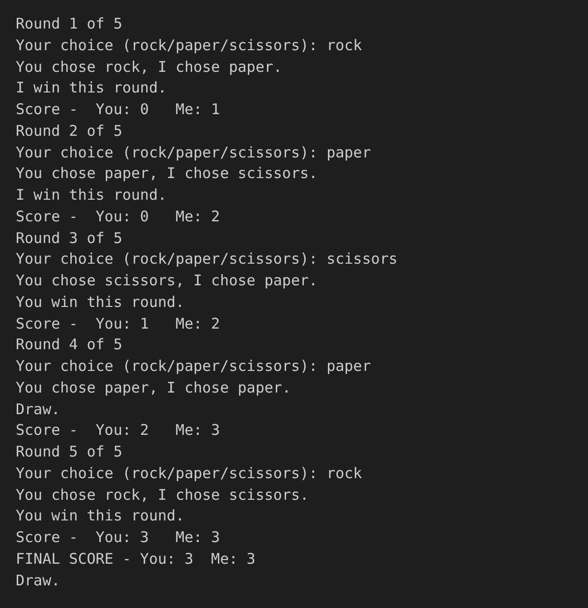

# Rock Paper Scissors

Rock-paper-scissors against the computer in the terminal, over 5 rounds. A win scores 1 point, a draw gives both players 1 point, and the final score decides the match.



## How to run it

You need Python 3. In PowerShell or cmd:
```
git clone https://github.com/bhargavsaideekonda/rock-paper-scissors.git
cd rock-paper-scissors
python rps.py
```
Type `rock`, `paper` or `scissors` in lowercase each round. Anything else counts as a loss for that round.

## What I built myself

- The computer's move: `random.choice()` picks from a list of the three options.
- The rules: one `if`/`elif` checks every way you can win (rock beats scissors, paper beats rock, scissors beats paper).
- A `for` loop that plays 5 rounds and keeps both scores, then prints the final score and the winner.

I built this with step-by-step help from Claude, an AI tutor. I typed and ran every line myself.
